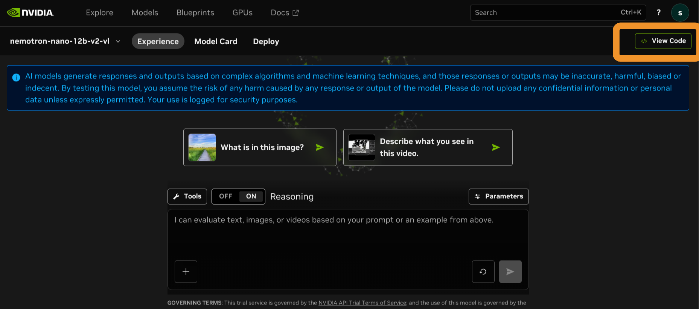
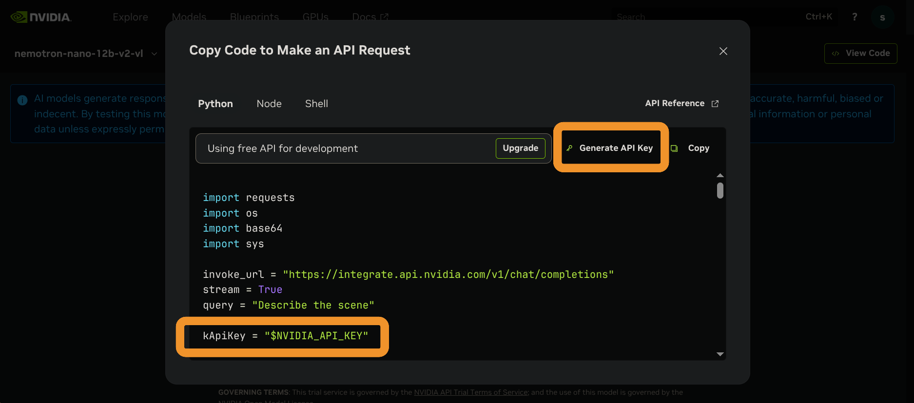

# Project Title

Project Description

## Overview

Project details

### Goals

List main objectives, problems you aim to solve.

### Features

- [x] Feature 1

- [x] Feature 2

- [ ] Feature 3

### Software Stack / Technologies Used

- Language: ...
- Framework: ...
- Database: ...
- etc...

## Quickstart

Summary for developers with links to setup, build, test instructions in wiki or docs.

### Instructions

1. Click "Use this template" on GitHub to create your private repository.
2. Clone your repo locally.
3. Fill in the metadata table above.
4. Create an initial branch (e.g., `setup`), never commit directly to `main` (unless instructed).
5. Open an Issue for each lab / feature before starting work.
6. Use Pull Requests to merge changes (each PR should reference at least one Issue).

---

### Nemotron CLI Prototype

1. Open [nvidia nemotron-nano ](https://build.nvidia.com/nvidia/nemotron-nano-12b-v2-vl)and sign up/ login.

2. Select View Code

   <!-- image: width=754 -->
   

    

3. Click Generate API Key 

   <!-- image: width=761 -->
   

4. Create a `.env` file in the project root with:

   - `API_KEY=<your_nvidia_api_key>`

5. Install dependencies:

   - `pip install requests python-dotenv`
   - `make install-file-picker-deps` (installs `zenity` and `kdialog` for browse mode)

6. Run the interactive command-line UI:

   - `make run-cli`

7. In the UI:

   - Enter a short maintenance description.
   - Choose browse mode to select an image in the file-picker dialog.
   - Submit to run inference against Nemotron.

8. Optional non-interactive usage:

   - `python nemotron.py --description "broken station light" /path/to/image.jpg`

## Structure

Include: what constitutes passing (e.g., all tests green, coverage threshold).

## Coding & Collaboration Conventions

- Use semantic commit messages (see `CONTRIBUTING.md` for full details).
- Open an Issue for every distinct unit of work (lab task, feature, bug, refactor, research).
- Create branches from `main` named after the Issue: `<type>/short-kebab` (e.g., `feat/scheduler-phase1`).
- Commit changes incrementally with semantic commit messages.
- Open a Pull Request early (draft) and link the Issue.
- Request peer review (if required) before merging.
- Squash merge or rebase to keep `main` linear (unless told otherwise).